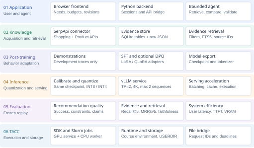

# TACC AgentForge

TACC AgentForge is a course project for **Advanced AI Computing and Systems**. The project explores how to deploy a large language model on the TACC platform and build a shopping and budget advisor on top of the deployed model.

## Project Goals

- Deploy and serve a large language model on TACC.
- Build an agent that can reason, use tools, and complete multi-step tasks.
- Acquire shopping evidence through SerpApi and build a source-linked knowledge base.
- Explore post-training to improve instruction following and tool use.
- Study model quantization and inference acceleration under limited GPU resources.
- Evaluate the system in terms of correctness, latency, throughput, and resource utilization.
- Study practical systems issues such as model loading, GPU scheduling, communication overhead, and inference optimization.

## Planned Architecture



SerpApi data will be normalized into a persistent SQLite knowledge base with
source links, timestamps, and versioned snapshots. The agent will retrieve
evidence and validate budgets before returning recommendations.

Training, quantization, and serving variants will be compared on fixed held-out tasks.

- [Development plan and design decisions](tasks/plan.md)
- [Implementation tasks and acceptance checks](tasks/todo.md)
- [Baseline design and pipeline metrics](docs/evaluation-metrics.md)
- [Two-page project proposal](output/pdf/shopping-budget-advisor-proposal.pdf)

The first deployed model is the course-provided `Qwen3.8-27B-AWQ-INT4`
checkpoint, served through vLLM with the API alias `qwen3.8-27b`.
Agent implementation, post-training, and new quantization are planned;
model and method selection depend on available TACC resources and compatibility.

## Verified TACC Deployment

On October 16, 2026, a two-GPU quantized service and a separate CPU client
successfully completed arithmetic and Chinese question-answering smoke tests.
The working configuration uses eager execution, 4K context, and tensor parallelism
of two. The original compiled 32K configuration did not become ready in the
first trial and is not claimed as verified. The service was stopped after testing.

- [Deployment and reproduction](deploy/tacc/README.md)
- [Experiment results and complete logs](docs/experiments/2026-10-16-27b/README.md)

This milestone deploys existing quantized weights; it does not yet implement
new quantization, an agent, or a performance benchmark.

## Prerequisites

- A registered TACC account and SSH public key
- The TACC `tcloud` SDK
- Python 3.10 or later
- Access to the compute resources required by the selected model

## TACC Setup

Configure the local `tcloud` client with your TACC username and private key:

```bash
tcloud config --username <TACC_USERNAME>
tcloud config --file <SSH_PRIVATE_KEY_PATH>
tcloud init
```

Do not commit private keys, passwords, access tokens, model credentials, or generated cluster configuration containing sensitive information.

## Planned Repository Structure

```text
tacc-agentforge/
|- agent/          # Agent planning, tools, and memory
|- app/            # Browser interface, backend, and TACC request bridge
|- knowledge/      # SerpApi acquisition, SQLite evidence, and retrieval
|- training/       # Post-training and adapter export
|- quantization/   # Model calibration and quantization
|- inference/      # Model client and serving benchmark
|- configs/        # Model, agent, and experiment configurations
|- scripts/        # TACC deployment and job scripts
|- evaluations/    # Benchmarks and evaluation tasks
|- tests/          # Automated tests
|- docs/           # Design notes and experiment reports
`- README.md
```

`app/`, `knowledge/` and `evaluations/` are empty placeholders for their owners.
Stub modules raise `NotImplementedError("TODO(Task N)")`; see [tasks/todo.md](tasks/todo.md).

## Roadmap

- [x] Initialize the project repository
- [x] Select an initial checkpoint and inference framework
- [x] Run a minimal inference job on TACC
- [x] Expose the model through a reusable inference interface
- [ ] Verify SDK file transfer and the TACC worker runtime
- [ ] Collect and normalize SerpApi shopping evidence
- [ ] Build versioned knowledge snapshots and evidence retrieval
- [ ] Implement the initial agent loop
- [ ] Add budget validation, tools, and session memory
- [ ] Connect the browser and backend to the TACC worker
- [ ] Design evaluation tasks and baselines
- [ ] Verify training resources and select a post-training model
- [ ] Prepare training data and run an SFT baseline
- [ ] Explore preference optimization if resources permit
- [ ] Quantize the selected model and evaluate quality-memory tradeoffs
- [ ] Benchmark inference acceleration with controlled comparisons
- [ ] Measure latency, throughput, and GPU utilization
- [ ] Document results and system limitations

## Status

Initial quantized model serving and API smoke tests are complete. The next
milestone is tool-using agent implementation and systematic evaluation.
Post-training, new quantization, and inference acceleration experiments remain
in the planning stage.

## Course

**Advanced AI Computing and Systems**

## License

No license has been selected yet. Unless a license is added, all rights are reserved by the repository owner.
